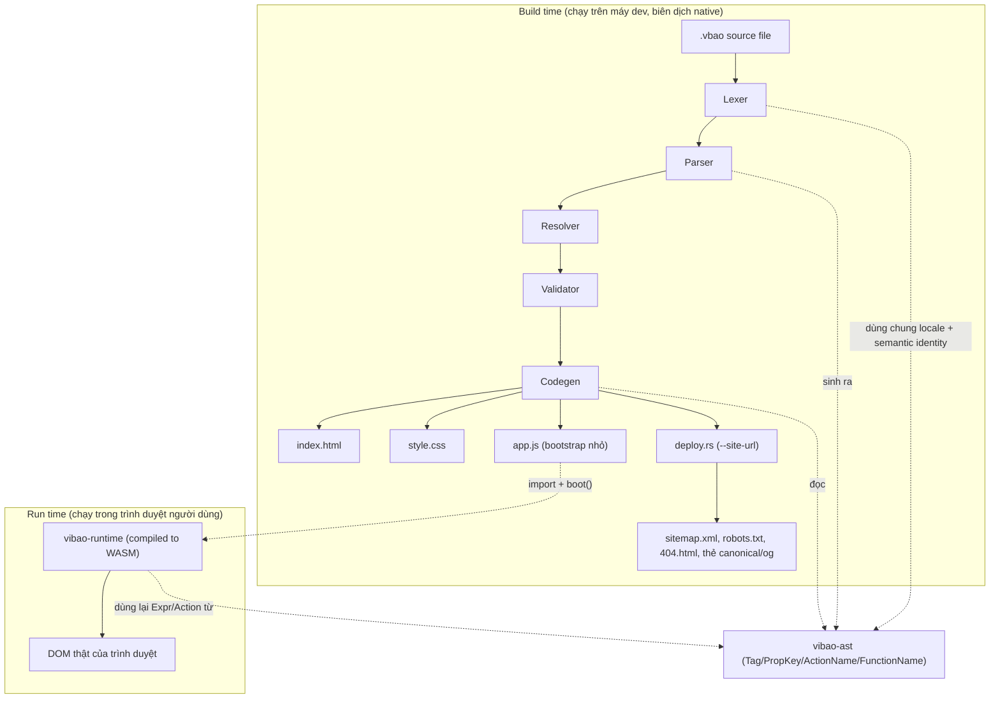
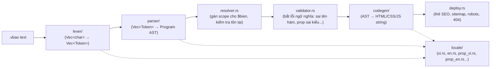
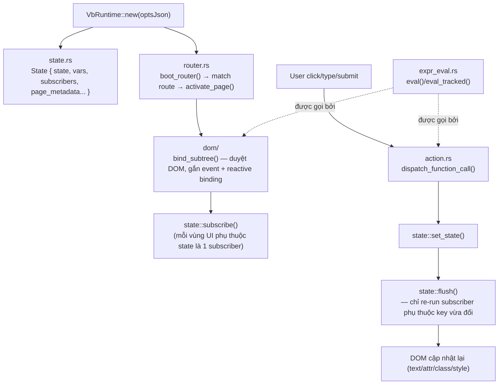
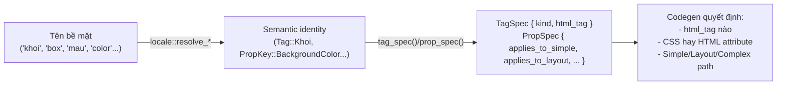

# Kiến trúc ViBao (v0.1.5)

Tài liệu này mô tả kiến trúc tổng thể của ViBao — dùng để định hướng
trước khi tối ưu/thêm tính năng, không phải tài liệu tham khảo cú pháp
(xem `VIBAO_SPEC.md` cho việc đó).

## Bức tranh toàn cảnh

ViBao có 3 crate độc lập, biên dịch riêng biệt cho 2 mục tiêu khác nhau:

Điểm quan trọng nhất: **`vibao-ast` là điểm giao duy nhất** giữa 2 thế
giới build-time (`vibaoc`, chạy native) và run-time (`vibao-runtime`,
biên dịch sang WASM). Không có crate nào khác phụ thuộc chéo lẫn nhau —
`vibaoc` không phụ thuộc `vibao-runtime` và ngược lại.

## 3 crate

| Crate | Biên dịch cho | Vai trò |
|---|---|---|
| `vibao-ast` | Native + WASM (dùng chung) | Định nghĩa cấu trúc dữ liệu (AST) và "semantic identity" (`Tag`, `PropKey`, `ActionName`, `FunctionName`) — nơi duy nhất biết "tên nào trong ngôn ngữ nào map vào khái niệm nào". |
| `vibaoc` | Native (CLI) | Compiler: đọc `.vbao`, sinh `index.html` + `style.css` + `app.js`. Không bao giờ chạy trong trình duyệt. |
| `vibao-runtime` | WASM | Chạy trong trình duyệt: đọc `optsJson` (embed sẵn trong `app.js`), quản lý reactive state, render/re-render DOM, xử lý event. |

## Luồng dữ liệu build-time (`vibaoc`)

- **`lexer/`** — biến chuỗi thô thành `Vec<Token>`. Tự chuẩn hoá tiếng
  Việt có dấu → không dấu (`vietnamese.rs`) trước khi tra bảng từ khoá.
  Luôn kiểm tra **cả 2 locale cùng lúc** (không chỉ locale khai báo
  trong `lang = "...";`) — đây là quyết định kiến trúc cốt lõi, xem
  `locale/mod.rs`.
- **`locale/`** — không thuộc lexer/parser/codegen, là 1 trục độc lập.
  Mỗi file map "tên bề mặt" (surface name, thứ dev gõ) → "semantic
  identity" (`Tag`/`PropKey`/`ActionName`/`FunctionName`, định nghĩa ở
  `vibao-ast::semantic`). Thêm ngôn ngữ mới = thêm 1 file locale mới,
  không đụng lexer/parser/codegen.
- **`parser/`** — đệ quy xuống theo cấu trúc lồng nhau của `.vbao`
  (`app.rs` cho `ung_dung`/`trang`/`@the`, `element.rs` cho thẻ UI,
  `control.rs` cho `neu`/`vong_lap`/`truong_hop`, `expr.rs` cho biểu
  thức, `action.rs` cho hành động trong event block).
- **`resolver.rs`** — gán mỗi `$bien` một scope cụ thể (global/page/
  loop/component), để codegen biết biến đó đọc từ đâu lúc runtime.
- **`validator.rs`** — lớp bắt lỗi "biết rồi nhưng sai" (khác lỗi cú
  pháp bắt ở lexer/parser): gọi hàm không tồn tại, tên màu sai, prop
  dùng nhầm tag... Sinh ra danh sách lỗi/warning, không tự sửa.
  `theme_check.rs` là một tầng con được `validator::validate` gọi: kiểm các
  quy tắc riêng của `chủ_đề` (cùng tập biến ở mọi theme, biến theme chỉ
  làm toàn bộ giá trị prop kiểu dáng, tên theme hợp lệ cho `đặt_chủ_đề`).
- **`codegen/`** — phần lớn nhất (~7500 dòng). Dịch mỗi `Element`
  thành HTML string theo 3 nhánh: **Simple** (`element.rs`, hầu hết
  thẻ), **Layout** (`layout.rs`, các thẻ có CSS flex/grid), **Complex**
  (`component.rs`, các UI phức tạp còn là placeholder — modal/tabs/
  chart...). `props.rs` là nơi tập trung dịch named-option (`mau:`,
  `dem:`...) sang CSS hoặc HTML attribute. `theme.rs` sinh CSS biến
  (`:root`, `@media (prefers-color-scheme: dark)`, `[data-vb-theme]`, kèm
  `--vb-theme: <tên>`), `global_style.rs` sinh rule `body`/`html` từ
  `giao_dien`.
- **`deploy.rs`** — chỉ chạy khi có `--site-url`: thẻ `canonical`/`og:url`/
  `og:image`/`twitter:card` cho `<head>`, `sitemap.xml`, `robots.txt`. Còn
  `404.html` (bản sao `index.html` khi có từ 2 route) do `main.rs` ghi.
- **`serve.rs`** — máy chủ HTTP cục bộ cho `vibaoc serve`: build, phục vụ
  `dist/` (route lạ trả về `index.html`), và build lại khi file nguồn đổi.

## Luồng dữ liệu run-time (`vibao-runtime`)

- **`state.rs`** — lõi reactive. `State` là 1 struct trung tâm (không
  phải nhiều biến rời), chứa toàn bộ state/subscriber/scope-stack của
  app. `subscribe()`/`flush()` là cơ chế dependency-tracking kiểu
  "signal" (giống Vue/Solid): mỗi lần 1 subscriber chạy, nó tự ghi lại
  những `state` key nào nó đã đọc (`current_tracking_deps`), để lần
  sau chỉ những subscriber thực sự phụ thuộc key vừa đổi mới bị chạy
  lại — không phải toàn bộ app.
- **`dom/`** — cầu nối giữa `State` và DOM thật, tách theo trách nhiệm:
  `subtree.rs` (`bind_subtree()` duyệt toàn bộ cây DOM 1 lần lúc trang
  active), `events.rs` (event listener), `model.rs` (2-way input binding),
  `conditional.rs` (`nếu`), `loop_render.rs` (`vòng_lặp`), `text_attr.rs`
  (text/style/attr binding động), `animation.rs`, và `ui.rs` (toast, cuộn,
  sao chép, `set_theme`).
- **`router.rs`** — SPA router. Mỗi "trang" trong `.vbao` là 1 `
`
  ẩn/hiện bằng `display`, không phải tách file — toàn bộ app là 1
  `index.html` duy nhất. `activate_page()` chạy mỗi lần chuyển route:
  reset state theo route, chạy lại `bind_subtree`, cập nhật
  `document.title`/`<meta description>`.
- **`expr_eval.rs`** — 1 trình thông dịch biểu thức (tree-walking
  interpreter) cho `Expr` (định nghĩa ở `vibao-ast`). Đây là **backend
  duy nhất** cho biểu thức động — không có JS-codegen riêng, mọi biểu
  thức `$a + $b`, `$arr.length`... đều eval qua đây lúc runtime, dựa
  vào `Expr` đã serialize sẵn vào `exprRegistry` lúc build.
- **`action.rs`** — dispatch cho action block (`khi_nhan { ... }`).
  Nhận `Vec<Action>` (đã serialize vào `actionRegistry` lúc build),
  chạy tuần tự, có unwind-safe cho `neu`/`ApiCall` lồng nhau. Một
  `ApiCall` có `background: true` được `spawn_local` tách rời và trả về
  ngay.
- **`api.rs`** — `fetch` cho `gọi_api`: JSON, header do người viết khai
  báo (ghi đè `Accept`/`Content-Type` mặc định), thông báo lỗi lấy từ
  `message` hoặc `error.message`.

### Chủ đề sáng/tối đi qua cả hai thế giới

`chủ_đề` được parse thành `Theme` trong AST; `theme_check.rs` kiểm tra; `codegen/theme.rs` sinh CSS biến;
`main.rs` ghi `data-vb-themes="sang,toi"` lên `<html>` và một script nhỏ trong `<head>` khôi phục
`localStorage["vb-theme"]` trước khi vẽ trang. Lúc chạy, `đặt_chủ_đề` (`dom::set_theme`) đặt `data-vb-theme` và
lưu lựa chọn; khi chưa chọn tay, theme hiện tại được suy ra từ biến CSS `--vb-theme`.

### Vì sao `on_tải` cần `chạy_nền`

`router::activate_page` chờ `on_tải` xong rồi mới `bind_subtree`. Một `gọi_api` thường trong `on_tải` do đó chặn việc gắn
sự kiện của cả trang cho tới khi mạng trả về. `chạy_nền: true` cho phép `on_tải` kết thúc ngay.

## `vibao-ast::semantic` — trục xuyên suốt cả 2 thế giới

Đây là điểm khác biệt lớn nhất so với 1 compiler thông thường: **không
có bảng string→string nào rải rác nhiều nơi**. Mọi quyết định "tên này
nghĩa là gì" đi qua đúng 1 con đường (`resolve_tag`/`resolve_prop_key`/
`resolve_action_name`/`resolve_function_name`), và mọi quyết định "khái
niệm này áp dụng được ở đâu" đi qua đúng 1 bảng tra (`tag_spec`/
`prop_spec`). Nhiều bug nghiêm trọng nhất tìm được trong quá trình đọc
code đều thuộc dạng: 1 chỗ trong codegen **bỏ qua**
lớp semantic này, tự so sánh chuỗi thô trực tiếp — dẫn tới lệch âm
thầm khi có 2 tên bề mặt cho cùng 1 khái niệm (song ngữ).

## Điểm mạnh của kiến trúc hiện tại

- Tách biệt build-time/run-time triệt để — không có "shared mutable
  state" nào giữa 2 thế giới, chỉ có 1 JSON snapshot 1 chiều
  (`optsJson`) lúc boot.
- Lớp `locale` độc lập hoàn toàn với parser/codegen — thêm ngôn ngữ
  mới không cần sửa logic dịch.
- Reactive core (`state.rs`) đúng kiến trúc signal, không phải
  virtual-DOM diffing — nhẹ, dễ trace bug hơn.
- Rất nhiều cross-check test tự động (đếm số lượng PropKey/Tag,
  đối chiếu 2 nguồn dữ liệu độc lập) — giúp bắt lỗi "quên cập nhật 1
  trong 2 chỗ" ngay khi chạy `cargo test`, không cần đợi runtime.

## Điểm yếu / rủi ro kiến trúc (để tối ưu tiếp)

Tóm tắt nhanh:

1. **`codegen/props.rs`** là 1 hàm `expand_props()` rất dài
   (match nhiều chục nhánh) — khó mở rộng an toàn, đã có ít nhất 2 bug
   thật xuất phát từ việc quên thêm 1 tag vào 1 trong nhiều điều kiện
   `matches!(tag, "a" | "b" | ...)` rải rác trong hàm này.
2. **`codegen/layout.rs`**: mỗi layout tag có 1 `resolve_*()` riêng +
   1 entry trong `known_layout_props()` — 2 nguồn phải tay đối tự đồng
   bộ, dù đã có test cross-check, vẫn là nơi dễ lệch nhất khi thêm
   tag/prop mới (đã xảy ra ít nhất 3 lần trong quá trình phát triển
   gần đây).
3. **Cú pháp hiện khá "phẳng"**: rất nhiều named-option dùng chung 1
   không gian tên (namespace) tại cấp `Element`, không phân nhóm theo
   ngữ nghĩa (spacing/color/typography/behavior...) — khiến quyết định
   "prop nào áp dụng cho tag nào" phải làm thủ công thay vì suy ra từ
   cấu trúc cú pháp.
4. **`vibao-runtime/dom.rs`** là file lớn nhất (~2300 dòng), gộp nhiều
   trách nhiệm (event, model-binding, if/loop rendering, router glue) —
   khó tách test độc lập cho từng phần vì tất cả cần DOM thật.
